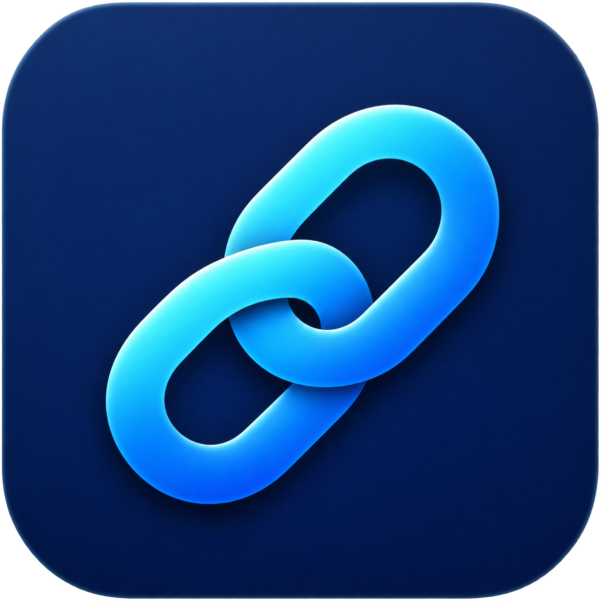

# FreeAPI



**自用项目，仅供别人参考。** 按作者自己的使用习惯维护，其他环境需要自行调整；不承诺通用兼容性或长期支持。

一个 macOS 菜单栏多后端 API 网关：把多个模型 API 集中管理，每个后端可以选择直连，或经 SSH 跳板机转发到本机回环地址。支持多个 SSH 隧道同时运行，也支持同一时间只运行一个。

```text
客户端 → 127.0.0.1:18189 → SSH 跳板机 → 模型 API
```

视觉稿见 [`design/freeapi-redesign.html`](design/freeapi-redesign.html)，原生界面按 Claude 暖米色 + 陶土橙的玻璃风格实现。

## 使用方式

打开 FreeAPI 后，菜单栏出现链环图标和状态圆点。点击图标打开快速弹层，点「打开主窗口」进入完整管理界面。应用退出时关闭全部隧道；没有 launchd 服务、登录启动项或系统代理设置。

| 状态 | 含义 |
| --- | --- |
| 绿色 | 已启用的后端全部可达 |
| 橙色 | 正在连接、恢复连接，或上游返回异常状态 |
| 红色 | 至少一个已启用后端连接失败 |
| 灰色 | 没有启用任何后端 |

**菜单栏弹层**：总开关、已连接计数、并行/单路模式、每个后端的开关/延迟/复制地址，以及打开主窗口和退出。

**主窗口**：左侧后端列表与搜索；右侧编辑名称、服务器地址、端口、协议、API 路径、本地端口、API Key 和 SSH 目标。SSH 拨杆关闭即直连，打开后自动生成 SSH 命令并可复制。底栏显示客户端应使用的 Base URL。

**运行模式**：

- 并行：每个 SSH 后端使用独立的本地端口，可以同时提供。
- 单路：同一时间只运行选中的后端，打开另一个会自动停用其它后端。

SSH 每 10 秒保活，连续 3 次无响应后断开；重试间隔逐步增加到 15 秒。每 15 秒检查一次 `/models`，连续两次网络失败会自动重建隧道；监听网络恢复和系统唤醒。正常退出或强制退出时，看护进程会清理 SSH 子进程。

## 配置与 iCloud 同步

需要 macOS 15 或更新版本，以及已经可以非交互登录的 SSH 密钥或 ssh-agent。先用终端连接自己的跳板机，确认主机指纹并完成首次登录。应用启用严格主机密钥检查和 `BatchMode`，不弹出密码输入框。

配置默认保存在 iCloud Drive：

```text
~/Library/Mobile Documents/com~apple~CloudDocs/FreeAPI/config.json
```

首次启动时，应用会创建这个文件夹，并把旧的 `~/Library/Application Support/FreeAPI/config.json` 复制过去；本机原文件保留为备份。如果本机副本比 iCloud 副本更新，会以本机修改时间较新的版本为准。之后每次修改会在约 0.4 秒内原子写入 iCloud Drive，并同步到登录同一 iCloud 账户的其它 Mac。应用每 8 秒检查一次文件变化，另一台设备改了配置后会自动载入。

如果 iCloud Drive 暂不可用，会自动回退到本机 `~/Library/Application Support/FreeAPI/config.json`。主窗口左下角的齿轮菜单可以查看当前配置位置、切换 iCloud Drive / 本机默认位置、选择其它文件夹、重新载入配置，或打开配置文件夹。

多端同时修改时采用最后写入覆盖；iCloud 产生的冲突副本不会自动合并。

通常不需要手写：在主窗口点「添加后端」填写即可。想手动准备时，可以复制示例：

```bash
mkdir -p "$HOME/Library/Mobile Documents/com~apple~CloudDocs/FreeAPI"
cp config.example.json "$HOME/Library/Mobile Documents/com~apple~CloudDocs/FreeAPI/config.json"
chmod 600 "$HOME/Library/Mobile Documents/com~apple~CloudDocs/FreeAPI/config.json"
```

如果使用本机位置，把上面的路径换成 `~/Library/Application Support/FreeAPI`。

示例字段：

```json
{
  "version": 2,
  "mode": "parallel",
  "backends": [
    {
      "id": "11111111-1111-1111-1111-111111111111",
      "name": "上海 GPU 集群",
      "transport": "ssh",
      "scheme": "http",
      "host": "api.internal.example.com",
      "port": 8189,
      "apiPath": "/v1",
      "localPort": 18189,
      "sshTarget": "user@bastion.example.com",
      "enabled": false
    }
  ]
}
```

- `transport`：`ssh` 或 `direct`。
- `host` / `port`：**跳板机或本机能访问**的 API 主机和端口，不填 `http://` 或路径。
- `localPort`：SSH 后端的本地监听端口，只绑定 `127.0.0.1`，范围 1024–65535；被占用或重复时会自动调整。
- `apiPath`：API 路径，例如 `/v1`；不带结尾斜杠，也可为空字符串。
- `sshTarget`：SSH 的 `user@host` 或 `~/.ssh/config` 中的 Host 别名。端口、密钥和 ProxyJump 可放在 SSH 配置里。
- 直连后端使用 `scheme`（`http` 或 `https`），SSH 后端的本机入口固定为 `http://127.0.0.1:<localPort>`。

旧版单隧道配置（`sshDestination` / `remoteHost` / `remotePort` / `localPort` / `apiPath`）会在启动时自动迁移成一个 SSH 后端，并在当前配置位置备份为 `config.v1.backup.json`。

API Key 保存在 macOS 钥匙串，不写入 `config.json`，也不出现在连接日志里。优先使用可随 iCloud 钥匙串同步的条目；读取旧的仅本机 Key 时会尝试创建同步副本。开启 iCloud 钥匙串后，多台 Mac 可以共用 Key；未开启时 Key 只在本机。它用于应用自己的连通性测试（`Authorization: Bearer`），不会替客户端添加鉴权头；客户端仍需填写自己的 Key。

绿色状态包含 HTTP 200、401 和 403：表示 HTTP 接口可达，不代表模型鉴权或生成请求已经成功。SSH 隧道转发的是 TCP，应用不做 TLS 终止；经 SSH 转发时请使用 HTTP 上游，HTTPS 上游请用直连或自行在跳板机侧处理证书。

## 构建与安装

安装 Apple Command Line Tools 后执行：

```bash
xcode-select --install    # 已安装则跳过
./scripts/test.sh
./scripts/package.sh
```

默认构建包含 Intel 和 Apple Silicon 的 Universal 应用。也可以指定架构：

```bash
./scripts/package.sh x86_64
./scripts/package.sh arm64
```

产物为 `build/FreeAPI.app` 和拖拽安装的 `dist/FreeAPI-2.1.1.dmg`。打开 DMG，把 FreeAPI 拖到 Applications，然后从应用程序文件夹启动。构建使用 ad-hoc 签名，未进行 Apple 公证。运行验证以作者的 Intel / macOS 15 环境为主；Apple Silicon 版本需要自行验证。

GitHub Actions 运行配置和进程清理测试，并构建 Universal 应用和 DMG。CI 不连接任何真实跳板机，也不需要密钥。

开发时可以用隔离配置预览界面，不影响本机配置：

```bash
FREEAPI_CONFIG_DIR=/tmp/freeapi-config \
FREEAPI_SHOW_WINDOW=1 \
  build/FreeAPI.app/Contents/MacOS/FreeAPI
```

## 客户端

使用示例配置时，OpenAI 兼容客户端的 Base URL 是：

```text
http://127.0.0.1:18189/v1
```

直连后端的 Base URL 就是它的上游地址，例如 `https://api.deepseek.com/v1`。每个 SSH 后端有自己的本地端口，可在列表和主窗口底部查看并复制。

在 CC Switch 中添加自定义供应商，填写对应地址、自己的 Key 和上游实际提供的模型 ID。模型上下文长度、图片输入和思考能力应以具体部署和实际测试为准。

Claude Code / Claude Desktop 使用 Anthropic 协议；如果上游只有 OpenAI Chat Completions，需要启用 CC Switch 的协议转换路由，并让 FreeAPI 和 CC Switch 同时保持运行。FreeAPI 本身只负责转发或提供地址。

## 可选 Hermes 兼容补丁

[`integrations/hermes/`](integrations/hermes/) 保存了作者使用 FreeAPI + DeepSeek 时遇到的重复思考字段问题的临时补丁。它单独安装，不随应用自动启用；作用范围和卸载方式见该目录说明。

## 卸载

从菜单选择「退出并关闭隧道」，然后把 FreeAPI 从应用程序文件夹拖到废纸篓。iCloud Drive 中的 `FreeAPI` 文件夹、本机配置目录 `~/Library/Application Support/FreeAPI`、钥匙串中的 `local.freeapi.apikey` 条目和下载的 DMG 可按需删除。没有系统后台服务需要卸载。Hermes 插件需按其独立说明移除。

## 仓库边界

本仓库包含应用源码、生成的应用图标、构建脚本、脱敏配置示例、视觉稿及可选兼容补丁。真实地址、SSH 密钥、API Key、运行日志和会话数据保留在本机。不要将自己的配置或客户端数据库提交到仓库。
