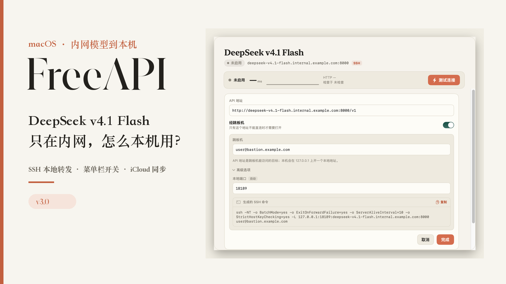
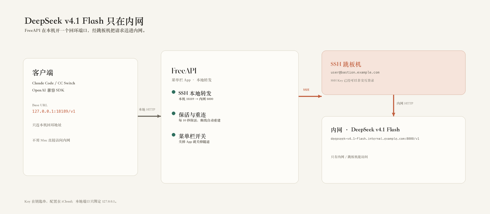
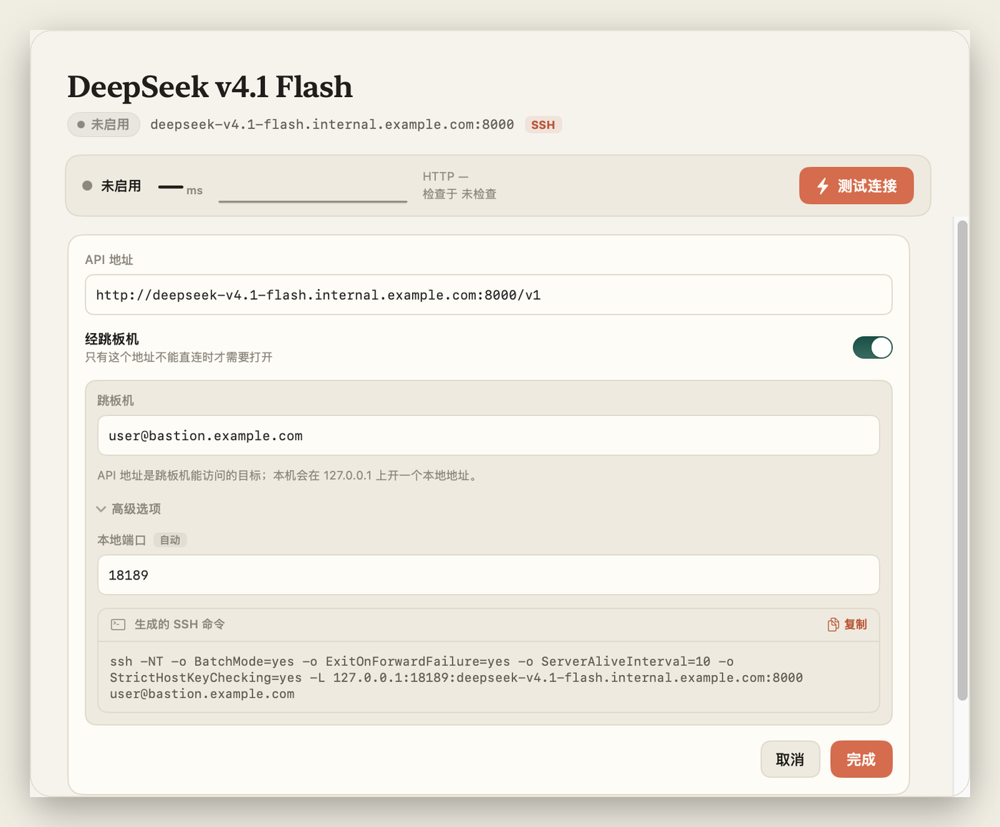
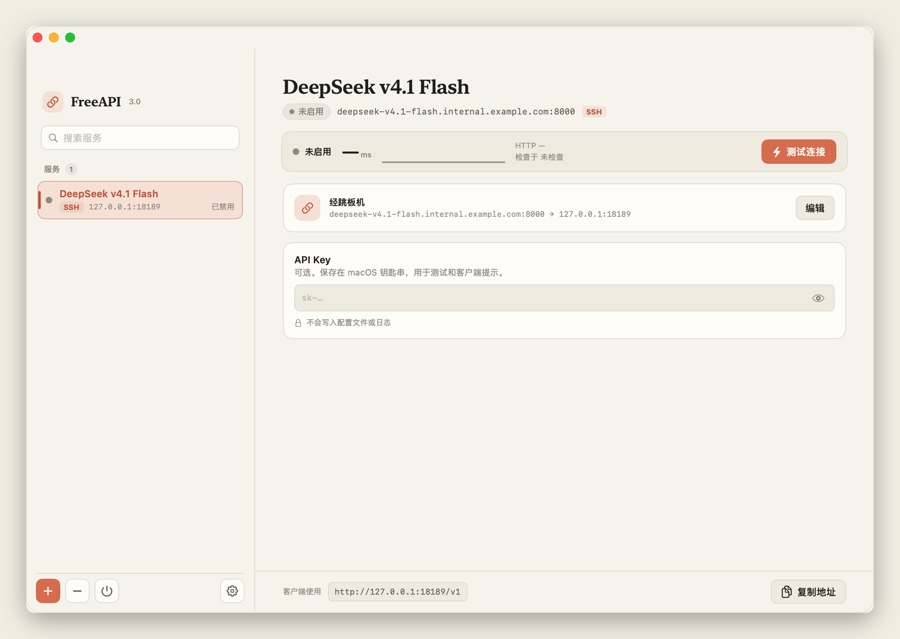

# DeepSeek v4.1 Flash 部署在内网，怎么拿到本机用？

**FreeAPI 3.0：把一条 `ssh -L` 收进菜单栏**



公司把 DeepSeek v4.1 Flash 部署在内网。模型是好用，可我人在工位，连不上。

要么连 VPN，要么每次开个终端敲 `ssh -L`，记住本地端口，再把客户端的 Base URL 改一遍。终端一关，转发就没了。用一次配一次，很烦。

后来我把这些动作写成了一个菜单栏 App，叫 FreeAPI。它在本机开一个 `127.0.0.1` 的端口，经跳板机把请求送进去，客户端只认这个本地地址。



*路径就一条：客户端 → `127.0.0.1:18189` → 跳板机 → 内网那台 DeepSeek v4.1 Flash。*

## 三步配好

1. 添加服务，地址填跳板机能访问的那个：`http://deepseek-v4.1-flash.internal.example.com:8000/v1`
2. 在服务详情里打开「经跳板机」，填 `user@bastion.example.com`；本地端口它会自己挑，我这里是 18189。
3. 复制生成的 SSH 命令，或者让它自己管这条隧道。



*填完地址和跳板机，本地端口和命令就出来了。截图里服务是停用的，所以显示「未启用」。*

客户端里填：

```text
http://127.0.0.1:18189/v1
```

模型 ID 写上游实际提供的那个，Key 写这个服务的。SSH Key 得先能免密登录跳板机，第一次连建议在终端里确认一下主机指纹。

## 隧道有人看着

- 每 10 秒探一次，连着三次没反应就断开重连，间隔逐次拉长。
- 每 15 秒请求一次后端；网络恢复、电脑唤醒后也会自己接上。
- 正常退出、强制退出，看护进程都会把 ssh 子进程清掉。
- 没装 launchd，也没动系统代理。关掉 App，隧道跟着关。

Key 存在钥匙串，配置文件里没有；配置放 iCloud Drive，换台 Mac 接着用。



*左边是服务列表，底栏能一键复制客户端地址。截图是演示数据。*

## 它不做什么

它只是把「已经能从跳板机访问的 API」搬到本机的 `127.0.0.1` 上。权限没有变多，也不是 VPN。SSH 转发的是 TCP，不做 TLS 终止，所以走隧道的上游我一般用 HTTP。系统要 macOS 15 以上，ad-hoc 签名，没过公证。

## 下载

Release 页面：

**https://github.com/hermanzhaozzzz/FreeAPI/releases/tag/v3.0.0**

下载 `FreeAPI-3.0.0.dmg`，退出旧版本，拖进 Applications。第一次打开被 Gatekeeper 拦了，就在 Finder 里右键「打开」。

自用项目，用得上的话可以试试，有问题去 GitHub 提 Issue。

---

*截图里都是演示数据：`example.com` 和内网示例地址，没有我的地址、SSH 目标和 Key。*
